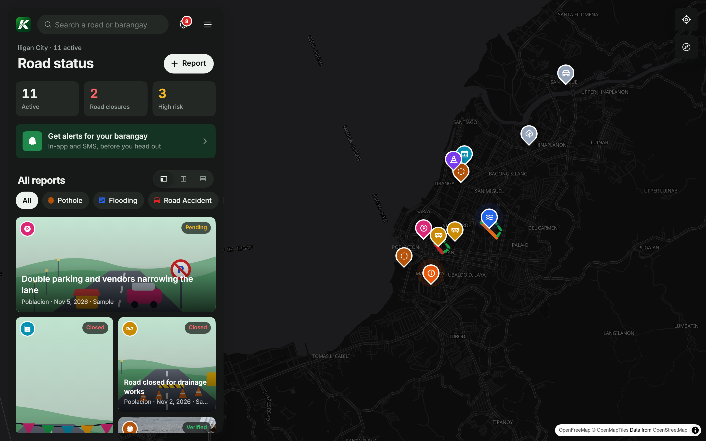
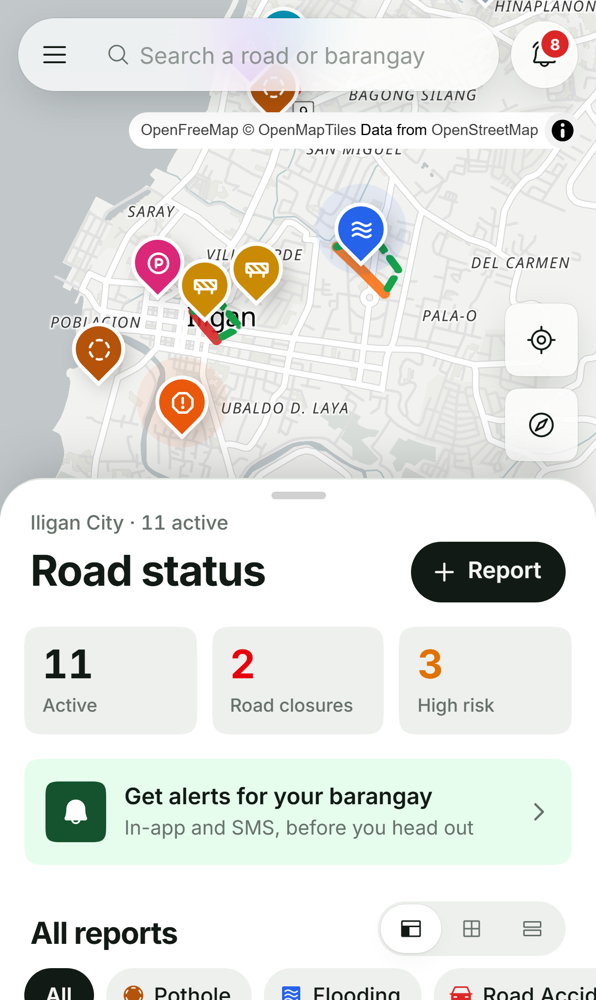
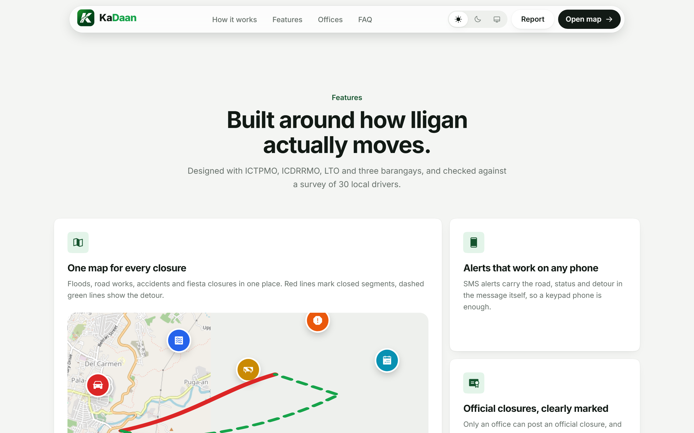

<div align="center">


# KaDaan

### Know the road before you leave.

Road reporting for **Iligan City**. Closures, floods and blocked lanes on one map, and every report goes to the barangay or city office that can act on it.

*Ka* (kasama, fellow) + *Daan* (road).

[**Live demo →**](https://kalsync-seven.vercel.app)


<br />


</div>

---

## Why

Road conditions in Iligan change by the hour: a flooded underpass, a stalled truck, a new pothole, a closure nobody announced. That information usually lives in scattered Facebook posts and group chats, and the offices that can fix it hear about it late. In the project's survey of 30 local drivers, **83%** only learn about an obstruction when they reach it, and **43%** don't always have mobile data while working.

**KaDaan** puts it all on one shared map, routes each report to the right office, and lets drivers follow the barangays they pass through.

## Screenshots

### The map

A full-screen map of Iligan with a resizable side panel: live counts, barangay alerts, category filters, and reports in gallery, grid or list view.


<table>
  <tr>
    <td width="66%"></td>
    <td width="34%"></td>
  </tr>
  <tr>
    <td align="center"><sub>Dark mode, with a dark vector map style</sub></td>
    <td align="center"><sub>On phones, a draggable bottom sheet</sub></td>
  </tr>
</table>

### Report details

Open any report to see its category, status, road status and severity, the offices it was sent to, and the closed segment (red) and detour (dashed green) on the map.


### Reporting

Photo, category, barangay, map pin and a note. No account needed.


### Landing page



## Features

| | |
|---|---|
| 🗺️ **Live road map** | MapLibre GL vector map of Iligan with category-coloured pins. High-severity hazards pulse. The map stays within the city's bounds. |
| 📊 **Road status at a glance** | Tiles for active reports, road closures and high-risk hazards; tap one to filter the list. |
| 🖼️ **Gallery, grid and list views** | Switch how reports are shown; the choice is remembered. Filter by category with chips. |
| 📍 **Report in seconds** | Take or upload a photo (up to 15 MB, downscaled before upload), choose one of 11 categories, pick the barangay and a map pin, add a note. Safety reminder and Data Privacy Act (RA 10173) consent before sending. |
| 🏛️ **Routed to the right office** | Barangay, ICTPMO, ICDRRMO, City Engineer's Office, DPWH or PNP, suggested from the category. |
| 🚧 **Advisory vs Officially Closed** | Official closures carry a resolution or permit number and the issuing office. Planned closures and events show start and end times. |
| 🛣️ **Segments and detours** | Closed segments in red, suggested detours as dashed green lines. |
| ✅ **Community confirmation** | "I've encountered this too", one per report per device, so real hazards rise to the top. |
| 🏷️ **Clear statuses** | Pending Verification → Verified → Resolved (or Rejected). Verifying and resolving are personnel actions. |
| 🔔 **Barangay alerts** | Follow any of the 44 barangays and optionally add an SMS number. The bell shows only what you follow. |
| 📡 **Live updates** | With Supabase connected, new and updated reports appear on the map in real time. |
| 📍 **Near me** | Shows how many active reports are within 5 km. Your location stays on your device. |
| 🌗 **Light, dark and system themes** | The map style switches with the theme. |
| 📱 **Phone-first** | Bottom sheet with snap points on mobile, a resizable floating panel on desktop (drag or use arrow keys). |

## Tech stack

| Layer | Tools |
|---|---|
| **UI** | [React 19](https://react.dev), [TypeScript 7](https://www.typescriptlang.org), [React Router 7](https://reactrouter.com) |
| **Styling** | [Tailwind CSS 4](https://tailwindcss.com) (via `@tailwindcss/vite`), `tailwind-merge`, [Inter Variable](https://rsms.me/inter/) font, [Phosphor Icons](https://phosphoricons.com) |
| **Maps** | [MapLibre GL 6](https://maplibre.org) with [`@vis.gl/react-maplibre`](https://visgl.github.io/react-maplibre/), free [OpenFreeMap](https://openfreemap.org) vector tiles (Positron and Dark styles, no API key) |
| **Backend** | [Supabase](https://supabase.com): Postgres with row-level security, RPC functions, Storage for photos, Realtime for live updates |
| **Offline / local mode** | IndexedDB (photos as Blobs) + localStorage when Supabase isn't configured |
| **Build and tooling** | [Vite 8](https://vite.dev), [oxlint](https://oxc.rs) |
| **Hosting** | [Vercel](https://vercel.com) (SPA rewrites in `vercel.json`) |

## Run it locally

```bash
git clone https://github.com/sirikitmac/KalSync.git
cd KalSync
npm install
npm run dev        # http://localhost:5173
```

Requires **Node 20.19+** (or 22.12+).

The app works without a backend: with no Supabase keys it runs in **local mode** and keeps data in your browser. To use Supabase, copy `.env.example` to `.env.local` and fill in your project's values:

```bash
VITE_SUPABASE_URL=https://YOUR-PROJECT.supabase.co
VITE_SUPABASE_ANON_KEY=YOUR-ANON-KEY
```

Database setup (schema, RLS, storage and realtime) is described in [`supabase/README.md`](supabase/README.md).

| Script | What it does |
|---|---|
| `npm run dev` | Start the Vite dev server |
| `npm run build` | Type-check and build to `dist/` |
| `npm run preview` | Serve the production build |
| `npm run lint` | Lint with oxlint |

## How it's built

```
src/
├── components/
│   ├── app/        AppMap, BottomSheet, PanelParts, ReportGallery
│   ├── alerts/     NotificationCenter, Toaster
│   ├── common/     Button, Modal, Badge, Logo, PlaceSearch, ThemeToggle
│   ├── landing/    Sections (Hero, HowItWorks, Features, FAQ, …), Phone mockups
│   ├── layout/     Navbar, Footer, AlertsModal, Splash
│   ├── map/        mapSetup, MapPin, MapFilters, PinPickerMap
│   └── reports/    ReportForm, ReportCard, ReportDetails, ReportList, …
├── context/        AppContext · ReportsContext · ThemeContext
├── services/       reportService · alertService · storageService · imageService
├── hooks/          useReports, useGeolocation, useMediaQuery, …
├── lib/            supabase client, reportUtils, deviceId, …
├── data/           categories, organizations, barangays, locations, demo reports
└── pages/          HomePage (/), MapPage (/map)
supabase/
└── migrations/     Tables, RLS policies, RPCs, storage bucket
```

UI components only talk to `ReportsContext`, which only talks to the `ReportService` interface. That interface has two implementations: Supabase, and a local browser one. Road users write only through RPC functions (`submit_report`, `confirm_report`, `save_alert_subscription`), so row-level security stays strict.

## Roadmap

- [x] Report flow with photo capture, pin picking and validation
- [x] Map, filters, confirmations, statuses and alerts
- [x] Office routing, official closures, schedules, segments and detours
- [x] Supabase: Postgres, Storage and Realtime
- [x] MapLibre vector maps, light/dark theme, mobile bottom sheet
- [ ] Personnel app for barangay / ICTPMO / ICDRRMO (verify, resolve, post closures)
- [ ] Real SMS and push delivery (an `sms_outbox` table is ready)
- [ ] Duplicate-report detection
- [ ] Real geocoding instead of the built-in place list

## Known limitations

- Reports marked **Sample** are demonstration data. Resolution and permit numbers on them are made up.
- SMS alerts are queued but not yet sent.
- Map tiles and demo photos need an internet connection. Cards fall back to a drawn illustration if a photo can't load.

---

<div align="center">
<sub>Built in Iligan City by <a href="https://github.com/sirikitmac">@sirikitmac</a></sub>
</div>
