<div align="center">


# KaDaan

### Know the road before you leave.

Road reporting for **Iligan City**. Closures, floods and blocked lanes on one map, and every report goes to the barangay or city office that can act on it.

*Ka* (kasama, fellow) + *Daan* (road).

[**Live demo →**](https://kalsync-seven.vercel.app)


<br />

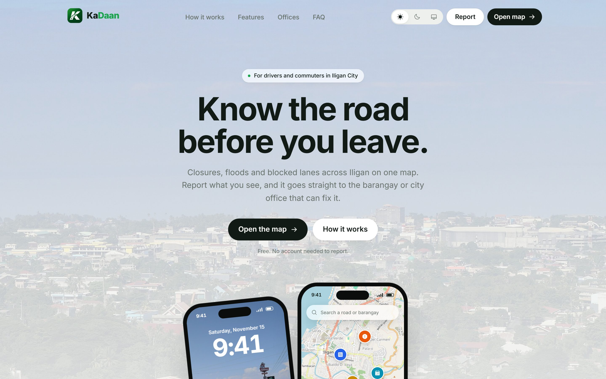

</div>

---

## Why

Road conditions in Iligan change by the hour: a flooded underpass, a stalled truck, a new pothole, a closure nobody announced. That information usually lives in scattered Facebook posts and group chats, and the offices that can fix it hear about it late. In the project's survey of 30 local drivers, **83%** only learn about an obstruction when they reach it, and **43%** don't always have mobile data while working.

**KaDaan** puts it all on one shared map, routes each report to the right office, and lets drivers follow the barangays they pass through.

## Screenshots

### The map

A full-screen map of Iligan with a resizable side panel: live counts, barangay alerts, category filters, and reports in gallery, grid or list view.

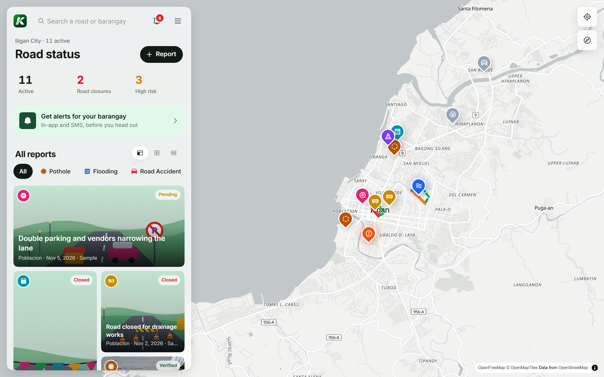

<table>
  <tr>
    <td width="66%"></td>
    <td width="34%"></td>
  </tr>
  <tr>
    <td align="center"><sub>Dark mode, with a dark vector map style</sub></td>
    <td align="center"><sub>On phones, a draggable bottom sheet</sub></td>
  </tr>
</table>

### Report details

Open any report to see its category, status, road status and severity, the offices it was sent to, and the closed segment (red) and detour (dashed green) on the map.

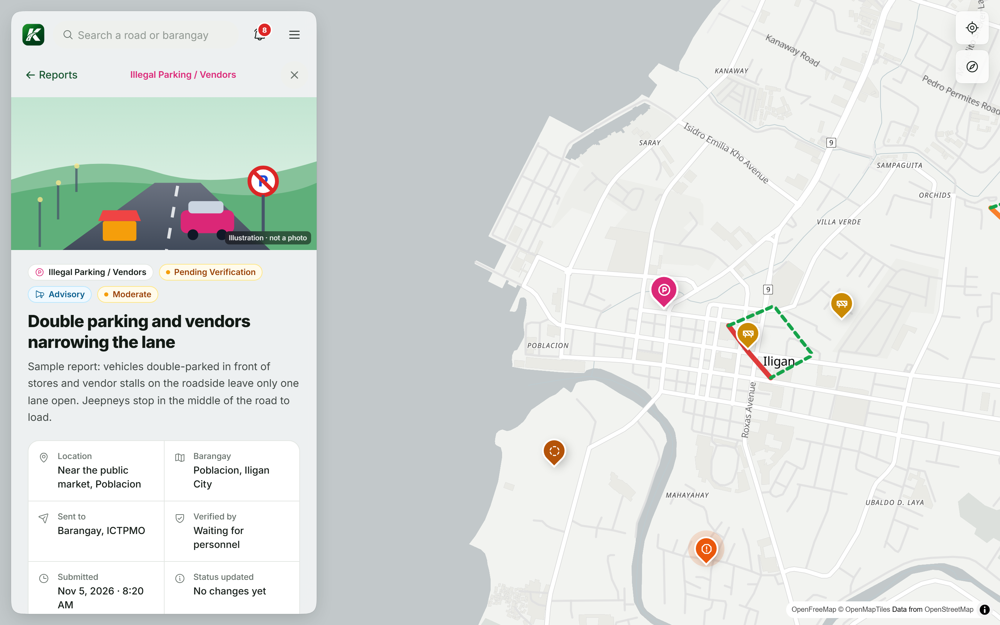

### Reporting

Photo, category, barangay, map pin and a note. No account needed.

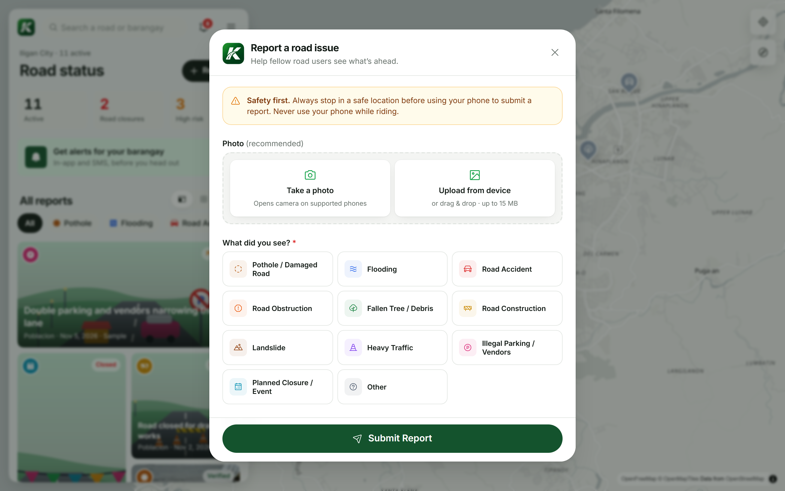

### Landing page


### On a phone

Most drivers in the survey open KaDaan on a phone, so this is the main layout. These shots use sample data.

**For road users**

<table>
  <tr>
    <td width="25%">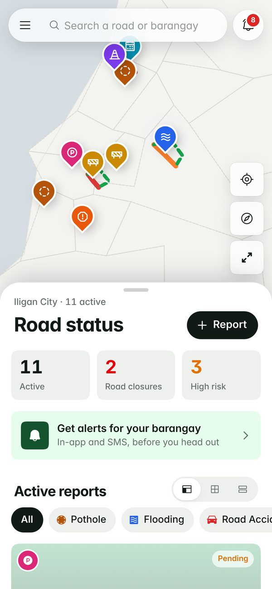</td>
    <td width="25%">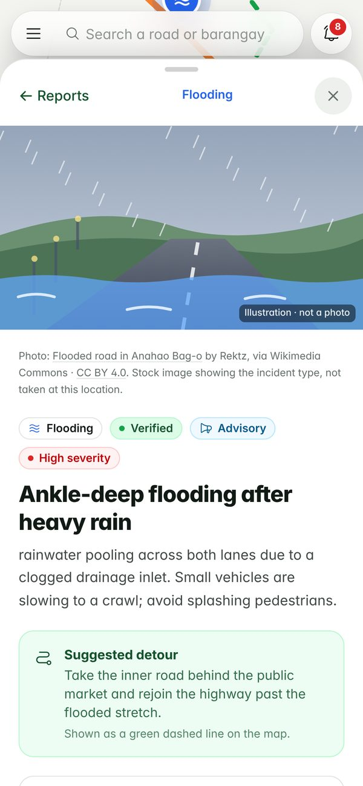</td>
    <td width="25%">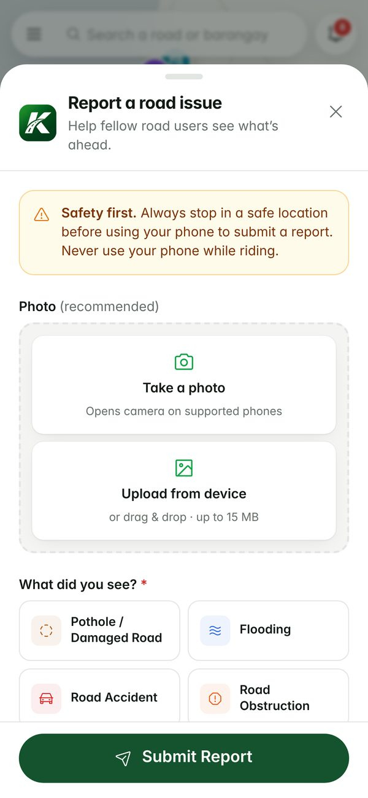</td>
    <td width="25%">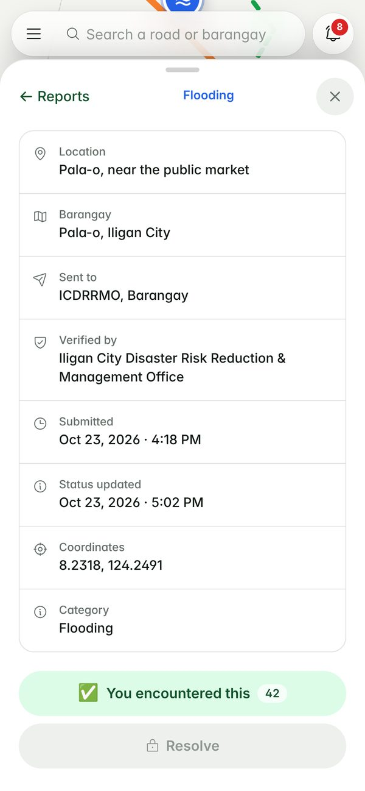</td>
  </tr>
  <tr>
    <td align="center"><sub>Map and report panel</sub></td>
    <td align="center"><sub>Report details and detour</sub></td>
    <td align="center"><sub>Reporting a road issue</sub></td>
    <td align="center"><sub>"I've encountered this too"</sub></td>
  </tr>
  <tr>
    <td>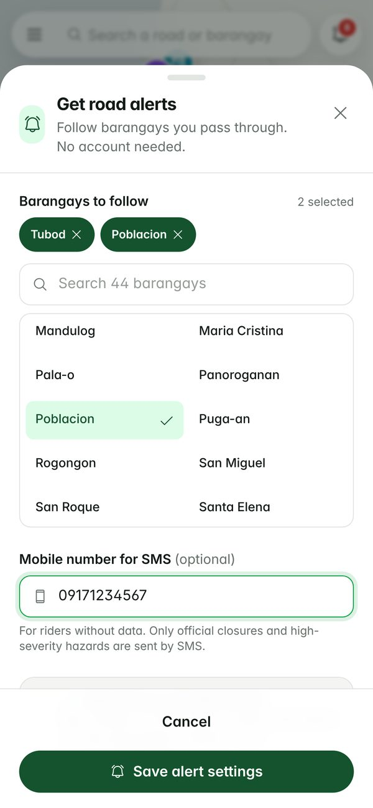</td>
    <td>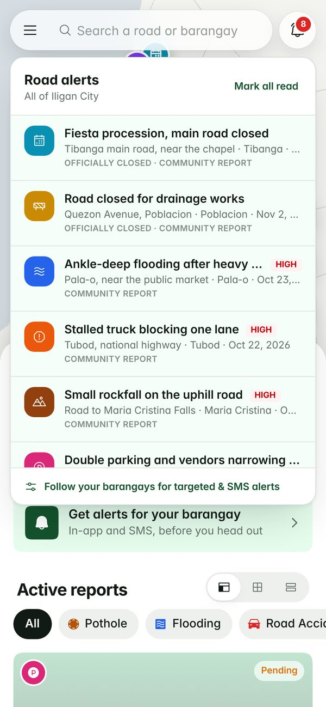</td>
    <td>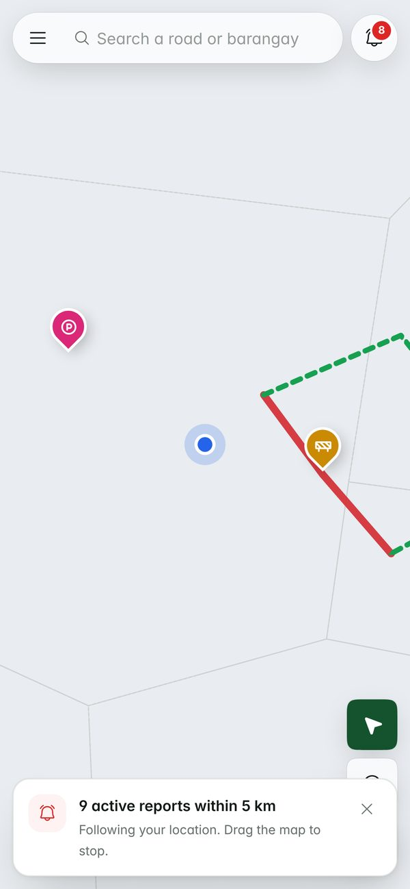</td>
    <td>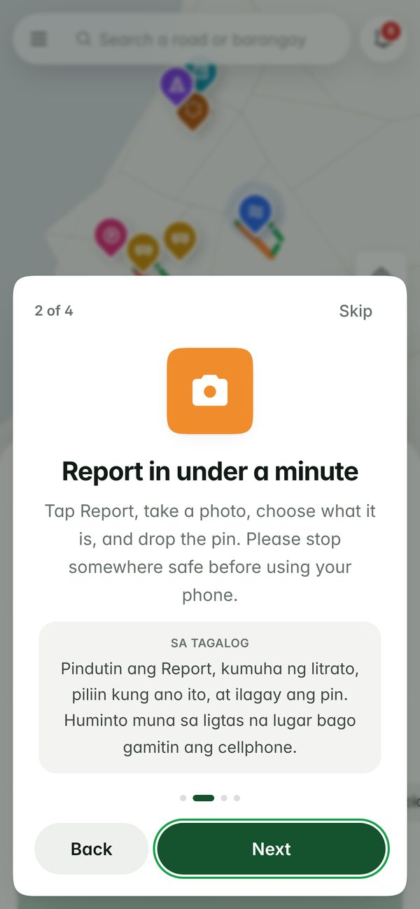</td>
  </tr>
  <tr>
    <td align="center"><sub>Follow barangays</sub></td>
    <td align="center"><sub>Alerts under the bell</sub></td>
    <td align="center"><sub>Follow my location, map only</sub></td>
    <td align="center"><sub>Welcome tour, with Tagalog</sub></td>
  </tr>
</table>

**For personnel** (barangay, ICTPMO, ICDRRMO)

<table>
  <tr>
    <td width="25%">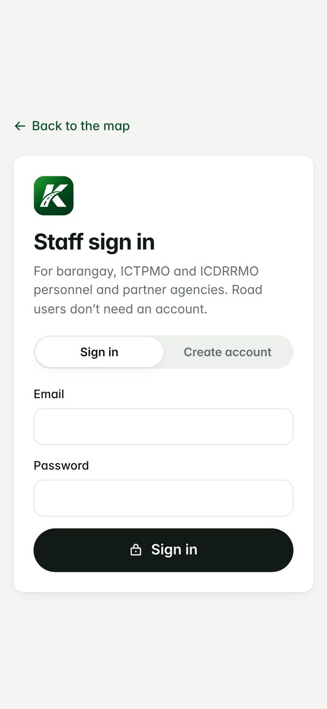</td>
    <td width="25%">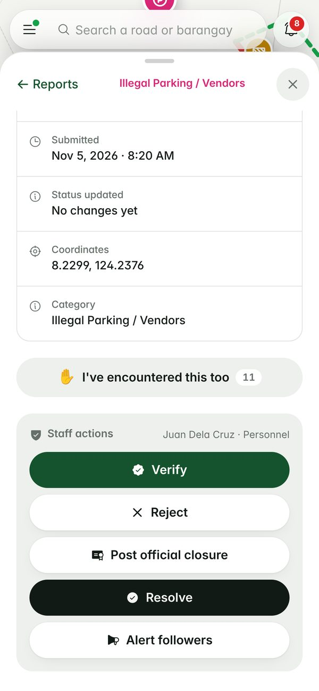</td>
    <td width="25%">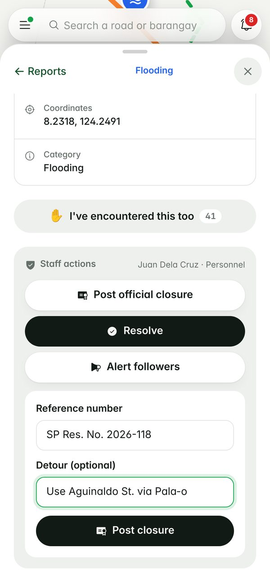</td>
    <td width="25%">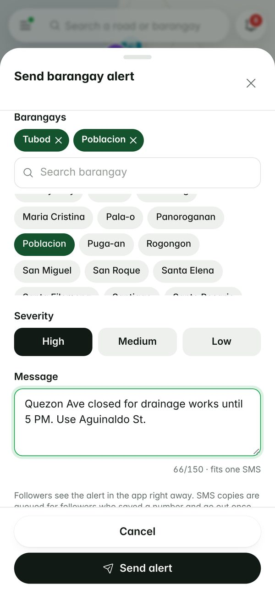</td>
  </tr>
  <tr>
    <td align="center"><sub>Staff sign in</sub></td>
    <td align="center"><sub>Verify, reject, resolve</sub></td>
    <td align="center"><sub>Official closure</sub></td>
    <td align="center"><sub>Send a barangay alert</sub></td>
  </tr>
  <tr>
    <td>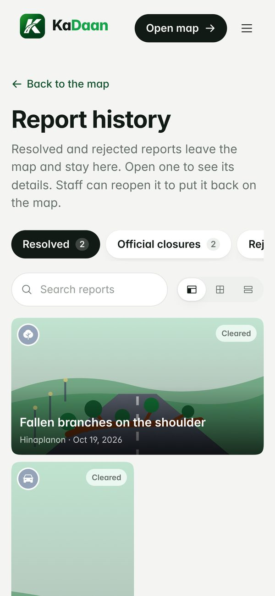</td>
    <td>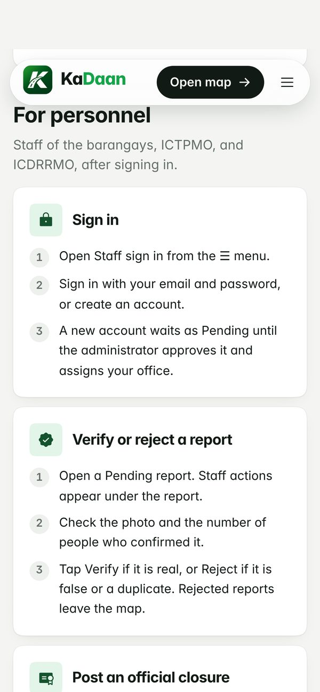</td>
    <td></td>
    <td></td>
  </tr>
  <tr>
    <td align="center"><sub>Report history</sub></td>
    <td align="center"><sub>In-app user guide</sub></td>
    <td></td>
    <td></td>
  </tr>
</table>

## Features

| | |
|---|---|
| 🗺️ **Live road map** | MapLibre GL vector map of Iligan with category-coloured pins. High-severity hazards pulse. The map stays within the city's bounds. |
| 📊 **Road status at a glance** | Tiles for active reports, road closures and high-risk hazards; tap one to filter the list. |
| 🖼️ **Gallery, grid and list views** | Switch how reports are shown; the choice is remembered. Filter by category with chips. |
| 📍 **Report in seconds** | Take or upload a photo (resized on the phone before upload), choose one of 11 categories and a severity, pick the barangay and a map pin. The description is optional. Safety reminder and Data Privacy Act (RA 10173) consent before sending. |
| 🏛️ **Routed to the right office** | Barangay, ICTPMO, ICDRRMO, City Engineer's Office, DPWH or PNP, suggested from the category. |
| 🚧 **Advisory vs Officially Closed** | Official closures carry a resolution or permit number and the issuing office. Planned closures and events show start and end times. |
| 🛣️ **Segments and detours** | Closed segments in red, suggested detours as dashed green lines. |
| ✅ **Community confirmation** | "I've encountered this too", one per report per device, so real hazards rise to the top. |
| 🏷️ **Clear statuses** | Pending Verification → Verified → Resolved (or Rejected). Resolved and rejected reports leave the map and move to Report history. |
| 🧑‍💼 **Staff tools** | Personnel sign in to verify or reject reports, post an official closure (a reference number is required), lift it, resolve one report or all shown, reopen from history, and alert a report's followers. Every change is logged with who made it. |
| 👤 **Accounts and roles** | Email and password sign-in. The first account becomes the admin; later accounts stay pending until the admin approves them and assigns an office. |
| 📢 **Barangay alerts from personnel** | Staff pick barangays and a severity and write a message that fits one SMS. Followers see it under the bell right away. |
| 🗂️ **Report history** | Resolved, official closures and rejected reports, with search and the same gallery, grid and list views. |
| 🔔 **Barangay alerts** | Follow any of the 44 barangays and optionally add an SMS number. The bell shows only what you follow. |
| 📡 **Live updates** | With Supabase connected, new and updated reports appear on the map in real time. |
| 🧭 **Follow my location** | The map follows you as you move and counts active reports within 5 km. Drag the map to pause. Your location stays on your device. |
| ⤢ **Map only** | Hide the panel to see the whole map; tapping a pin brings it back. |
| 📖 **Welcome tour and user guide** | A four-card tour on first use, each card also in Tagalog, and a *How to use KaDaan* page for road users and personnel. |
| 🌗 **Light, dark and system themes** | The map style switches with the theme. |
| 📱 **Phone-first** | Bottom sheet with snap points on mobile, a resizable floating panel on desktop (drag or use arrow keys). |

## Tech stack

| Layer | Tools |
|---|---|
| **UI** | [React 19](https://react.dev), [TypeScript 7](https://www.typescriptlang.org), [React Router 7](https://reactrouter.com) |
| **Styling** | [Tailwind CSS 4](https://tailwindcss.com) (via `@tailwindcss/vite`), `tailwind-merge`, [Inter Variable](https://rsms.me/inter/) font, [Phosphor Icons](https://phosphoricons.com) |
| **Maps** | [MapLibre GL 6](https://maplibre.org) with [`@vis.gl/react-maplibre`](https://visgl.github.io/react-maplibre/), free [OpenFreeMap](https://openfreemap.org) vector tiles (Positron and Dark styles, no API key) |
| **Backend** | [Supabase](https://supabase.com): Postgres with row-level security, RPC functions and triggers, Auth for staff accounts, Storage for photos, Realtime for live updates |
| **Offline / local mode** | IndexedDB (photos as Blobs) + localStorage when Supabase isn't configured |
| **Build and tooling** | [Vite 8](https://vite.dev), [oxlint](https://oxc.rs) |
| **Hosting** | [Vercel](https://vercel.com) (SPA rewrites in `vercel.json`) |

## Run it locally

```bash
git clone https://github.com/sirikitmac/KalSync.git
cd KalSync
npm install
npm run dev        # http://localhost:5173
```

Requires **Node 20.19+** (or 22.12+).

The app works without a backend: with no Supabase keys it runs in **local mode** and keeps data in your browser. To use Supabase, copy `.env.example` to `.env.local` and fill in your project's values:

```bash
VITE_SUPABASE_URL=https://YOUR-PROJECT.supabase.co
VITE_SUPABASE_ANON_KEY=YOUR-ANON-KEY
```

Database setup is described in [`supabase/README.md`](supabase/README.md). In short: run the files in `supabase/migrations/` in order in the Supabase SQL Editor (each one is safe to run again), then sign up on `/login`. The first account becomes the admin.

#### Demo mode

For class presentations, `20261121030000_demo_mode.sql` turns on a switch that lets **anyone** use the staff actions without signing in. Turn it off before real use:

```sql
update private.settings set value = false where key = 'demo_mode';
```

The sample reports (`KD-DEMO-0001` to `KD-DEMO-0015`) can be removed with:

```sql
delete from public.reports where id like 'KD-DEMO-%';
```

| Script | What it does |
|---|---|
| `npm run dev` | Start the Vite dev server |
| `npm run build` | Type-check and build to `dist/` |
| `npm run preview` | Serve the production build |
| `npm run lint` | Lint with oxlint |

## How it's built

```
src/
├── components/
│   ├── app/        AppMap, BottomSheet, PanelParts, ReportGallery
│   ├── alerts/     NotificationCenter, Toaster
│   ├── common/     Button, Modal, Badge, Logo, PlaceSearch, ThemeToggle
│   ├── guide/      WelcomeTour
│   ├── landing/    Sections (Hero, HowItWorks, Features, FAQ, …), Phone mockups
│   ├── layout/     Navbar, Footer, AlertsModal, Splash
│   ├── map/        mapSetup, MapPin, MapFilters, PinPickerMap
│   ├── reports/    ReportForm, ReportCard, ReportDetails, ReportList, …
│   └── staff/      StaffActions, SendAlertModal, BulkResolveModal
├── context/        AppContext · AuthContext · ReportsContext · ThemeContext
├── services/       reportService · alertService · staffService · storageService · imageService
├── hooks/          useReports, useGeolocation, useMediaQuery, …
├── lib/            supabase client, reportUtils, deviceId, …
├── data/           categories, organizations, barangays, locations, demo reports
└── pages/          HomePage (/), MapPage (/map), LoginPage (/login), HistoryPage (/history), HelpPage (/help)
supabase/
└── migrations/     Tables, RLS policies, RPCs, storage bucket, staff roles, demo mode, sample reports
```

UI components only talk to `ReportsContext`, which only talks to the `ReportService` interface. That interface has two implementations: Supabase, and a local browser one. Road users write only through RPC functions (`submit_report`, `confirm_report`, `save_alert_subscription`), so row-level security stays strict.

## Roadmap

- [x] Report flow with photo capture, pin picking and validation
- [x] Map, filters, confirmations, statuses and alerts
- [x] Office routing, official closures, schedules, segments and detours
- [x] Supabase: Postgres, Storage and Realtime
- [x] MapLibre vector maps, light/dark theme, mobile bottom sheet
- [x] Staff accounts and roles (first account is admin, others need approval)
- [x] Personnel tools: verify, reject, official closures, resolve, reopen, report history
- [x] Barangay alerts sent by personnel
- [x] Follow my location and map-only mode
- [x] Welcome tour (with Tagalog) and in-app user guide
- [ ] Real SMS delivery through an SMS gateway (an `sms_outbox` queue is ready)
- [ ] Advance alerts before a scheduled closure starts
- [ ] Shared incident feed and profile pages for partner agencies (LTO, PNP, CEO, DPWH)
- [ ] Drawing closed segments and detours in the staff tools (they come with the data today)
- [ ] Admin screen to approve staff accounts
- [ ] Duplicate-report detection
- [ ] Offline support (service worker) and push notifications
- [ ] Real geocoding instead of the built-in place list
- [ ] Bisaya translation

## Known limitations

KaDaan is a class prototype (ISY108, MSU-IIT), not a production system.

- **SMS is not sent.** Alerts reach followers in the app. One SMS per follower is saved in `sms_outbox`, but no SMS gateway is connected, because that needs a paid provider and a registered sender name.
- **Demo mode is on in the live demo**, so anyone with the link can verify, close and resolve reports and send alerts. Turn it off for real use (see above).
- **Sample data.** Reports marked **Sample** and the `KD-DEMO-*` reports are made up, including their resolution and permit numbers.
- **No admin screen for accounts.** New staff accounts are approved and given an office in the Supabase SQL Editor ([`supabase/README.md`](supabase/README.md)).
- **No partner agency features yet.** LTO, PNP, CEO and DPWH can be chosen as offices to notify, but they have no login, shared feed or profile page.
- **No advance alerts** for scheduled closures; followers are alerted when a report is posted, not before it starts.
- **Segments and detours** can't be drawn in the app yet; only the detour text can be entered.
- **Needs an internet connection.** There is no service worker, so the app and the map tiles don't work offline. "Add to Home Screen" works as a shortcut.
- **Location** works only over HTTPS (the Vercel link, not a phone opening the dev server by IP).
- **Iligan City only.** The map is limited to the city's bounds and its 44 barangays.
- **English only**, except the Tagalog lines in the welcome tour.
- The app is not an emergency service and does not dispatch responders; call the emergency hotline for accidents with injuries.

---

<div align="center">
<sub>Built in Iligan City by <a href="https://github.com/sirikitmac">@sirikitmac</a></sub>
</div>
